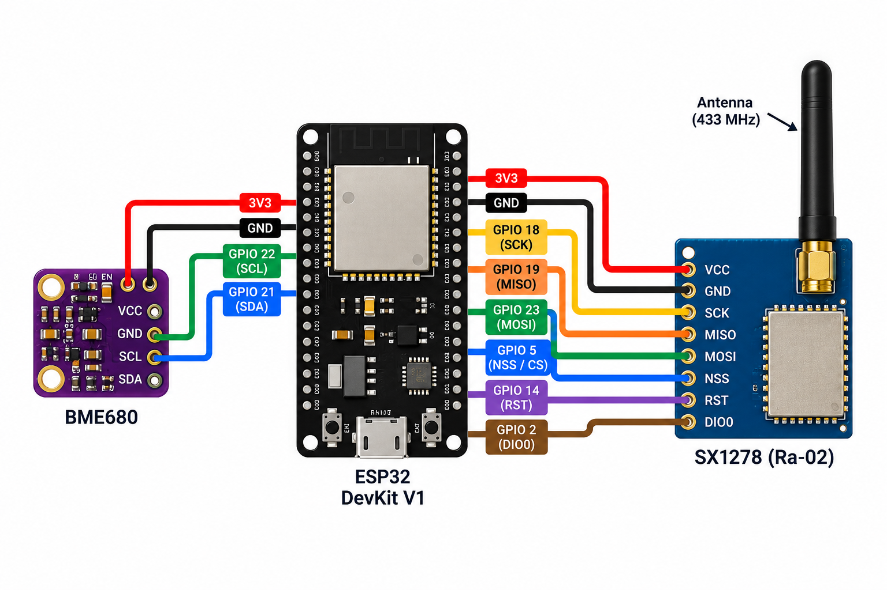

# Algae-Based Bio-Air Purification for Carbon Emission Reduction

**Individually Deployable Purification Units · Real-Time Cloud Monitoring · LoRa-Based Inter-Unit Communication · Emission Control**

An algae-based bio-air purification system designed to support carbon emission reduction through independently deployable units. Each unit collects environmental data and connects to a cloud platform for real-time metrics visualization and monitoring. LoRa enables inter-unit data exchange when network connectivity is unavailable.

## Team .env

- Srevarshan S
- Pranav S
- Shanmyukthaa D
- Archana S

## Overview

The ESP32 reads temperature, humidity, atmospheric pressure, and gas resistance from a BME680 sensor. Each reading follows two communication paths:

- **LoRa:** Transmits the payload to a compatible nearby receiver and supports inter-unit data exchange.
- **HTTPS:** Sends the payload to AWS API Gateway. AWS Lambda validates the request and stores the reading in Amazon DynamoDB.

The current firmware sends telemetry every **10 seconds**. LoRa transmission is performed independently of the HTTPS request; automatic cloud-to-LoRa failover routing between units is not implemented by this transmitter alone.

## Hardware

| Component | Purpose |
|---|---|
| ESP32-WROOM-32 | Reads sensor data and manages communication |
| BME680 | Measures temperature, humidity, pressure, and gas resistance |
| SX1278 Ra-02 | LoRa communication at 433 MHz |
| 433 MHz antenna | LoRa transmission and reception |
| Jumper wires | Hardware connections |
| USB power supply | Powers the ESP32 |

## Circuit Diagram



### BME680 to ESP32

| BME680 pin | ESP32 pin |
|---|---|
| VCC | 3V3 |
| GND | GND |
| SDA | GPIO 21 |
| SCL | GPIO 22 |

### SX1278 Ra-02 to ESP32

| SX1278 pin | ESP32 pin |
|---|---|
| VCC | 3V3 |
| GND | GND |
| SCK | GPIO 18 |
| MISO | GPIO 19 |
| MOSI | GPIO 23 |
| NSS / CS | GPIO 5 |
| RST | GPIO 14 |
| DIO0 | GPIO 2 |

Use a suitable 3.3 V supply for the SX1278 and connect an appropriate 433 MHz antenna before transmitting. Confirm the pin labels on your particular breakout boards before wiring.

## Data Flow

1. The ESP32 connects to Wi-Fi and synchronizes its clock.
2. The BME680 provides an environmental reading.
3. The ESP32 formats the reading as JSON.
4. The payload is transmitted over LoRa.
5. The same payload is sent over HTTPS to API Gateway.
6. Lambda checks the device token and stores the reading in DynamoDB.

## AWS Services

| Service | Role |
|---|---|
| Amazon API Gateway | Receives HTTPS telemetry requests |
| AWS Lambda | Validates and processes each request |
| Amazon DynamoDB | Stores sensor readings |

## Setup

1. Install the Arduino IDE and ESP32 board support.
2. Install these Arduino libraries:
   - Adafruit BME680
   - Adafruit Unified Sensor
   - LoRa by Sandeep Mistry
3. Copy `secret.example.h` to `secrets.h`.
4. Add your Wi-Fi credentials, API token, and Amazon Root CA certificate to `secrets.h`.
5. Confirm the API endpoint in `air_node.ino`.
6. Open `air_node.ino`, select the correct ESP32 board and port, then upload.
7. Open Serial Monitor at **115200 baud** to check sensor readings, LoRa transmission, and HTTPS responses.

## Configuration and Security

- The API token in `secrets.h` must match the `DEVICE_TOKEN` value configured in Lambda.
- Keep `secrets.h` private. Do not commit Wi-Fi passwords, API tokens, certificates, or private keys.
- Ensure `.gitignore` excludes `secrets.h`.
- HTTPS certificate validation requires the correct root CA certificate and a synchronized system clock.

## Repository Structure

```text
env-hacks-2026/
├── Docs/
│   └── Air-node-wiring.png
├── air_node.ino
├── secret.example.h
├── .gitignore
└── README.md
```

## Notes

- BME680 gas resistance is not a direct CO₂ or PM2.5 measurement.
- LoRa reception requires a compatible receiver using matching radio settings.
- A dashboard can retrieve readings through a separate read-only API.
- Carbon emission reduction depends on the algae system's design and measured performance; the BME680 readings alone do not quantify carbon capture.
